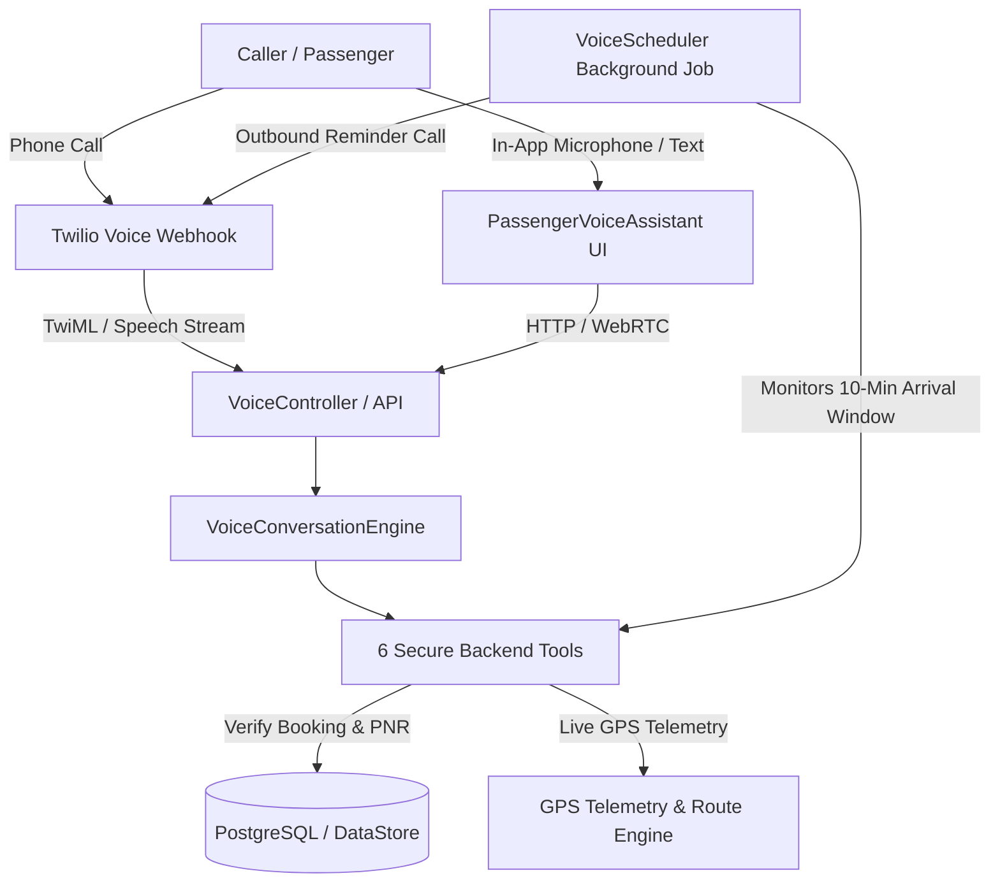

# SMART ROUTE BOOKING — AI Voice System Integration Guide

## 1. Architectural Overview

The AI Voice System in SMART ROUTE BOOKING delivers a human-like, two-way conversational voice experience integrated directly into the existing commercial mobility application.

The system consists of three operational pillars:
1. **In-App Passenger AI Voice Assistant**: Accessible from the passenger navigation bar and floating widget with real-time speech synthesis, Web Speech recognition, barge-in support, live transcripts, and verified data cards.
2. **AI Telephone Support (Inbound Calls)**: Real-time telephony integration via Twilio Voice webhooks, providing natural spoken dialogue in Tamil, English, and Tanglish with barge-in (`bargeIn="true"`), context memory, and strict identity verification.
3. **Automatic Outbound Boarding & Dropping Calls**: Persistent background scheduler (`voiceScheduler.js`) that monitors trips, detects when a bus is within ~10 minutes of a passenger's boarding stop, and triggers proactive voice alerts with idempotency, backoff retries, and opt-out compliance.



---

## 2. Secure Backend Tools & Permissions

The AI Assistant uses 6 verified server-side operations (`voiceAssistantService.js`):

| Tool | Purpose | Permissions & Privacy |
| :--- | :--- | :--- |
| `getBookingStatus` | Retrieves PNR status, route, travel date, and bus number | Passenger owns booking OR caller mobile matches contact mobile |
| `getPassengerTripDetails` | Retrieves seat numbers, seat types, bus amenities, scheduled times | Passenger owns booking OR verified caller |
| `getBusLocationAndETA` | Retrieves live coordinates, next stop, and ETA | Strictly verifies telemetry timestamp (<5 min freshness). Honestly explains standby when tracking is inactive |
| `getBoardingAndDroppingDetails`| Retrieves exact boarding stop, platform bay, scheduled times | Passenger owns booking OR verified caller |
| `getNextRouteStop` | Retrieves upcoming route stop in ordered route sequence | Public read-only trip information |
| `getDriverBoardingManifest` | Retrieves stop-wise passenger manifest | **STRICTLY RESTRICTED** to authenticated driver assigned to the trip |

---

## 3. Telephony & Webhook Endpoints

| Method | Endpoint | Description |
| :--- | :--- | :--- |
| `POST` / `GET` | `/api/voice/inbound` | Answers incoming telephone call with natural Tamil/Tanglish greeting and continuous barge-in gather |
| `POST` | `/api/voice/inbound/message` | Processes spoken turns during active call, resolves tools, and responds with TwiML |
| `POST` | `/api/voice/status` | Reconciles call status (`queued`, `ringing`, `in-progress`, `completed`, `failed`) |
| `POST` | `/api/voice/opt-out` | Allows passengers to opt out of automated reminder calls |
| `GET` | `/api/voice/reminders` | Administrative view of scheduled and dispatched reminder logs |
| `POST` | `/api/voice/session` | Generates ephemeral credentials for WebRTC in-app voice sessions |
| `POST` | `/api/voice/chat` | Conversational voice and text fallback endpoint for in-app assistant |

---

## 4. Multi-Language & Barge-In Capabilities

- **Languages Supported**: Hindi (`hi-IN`), Tamil (`ta-IN`), English (`en-IN`), and Tanglish (Tamil-English code-mixing).
- **Conversational Greetings**:
  - Hindi: *"नमस्ते! स्मार्ट रूट बुकिंग AI असिस्टेंट बोल रहा हूँ। बताइये, आपकी यात्रा के बारे में क्या सहायता कर सकता हूँ?"*
  - Tanglish: *"Vanakkam! Smart Route Booking AI assistant pesuren. Sollunga, eppadi help pannanum?"*
  - Tamil: *"வணக்கம்! ஸ்மார்ட் ரூட் புக்கிங் AI அசிஸ்டன்ட் பேசுகிறேன். சொல்லுங்கள், உங்களுக்கு எவ்வாறு உதவலாம்?"*
  - English: *"Hello! This is Smart Route Booking AI assistant. How can I assist you with your journey today?"*
- **Barge-in / Interruption**: Configured with `bargeIn="true"` in TwiML and programmatic speech cancellation in the frontend so callers and passengers can interrupt the assistant naturally.

---

## 5. Automated Reminder Scheduling & Idempotency

- **Idempotency Key**: `${trip_id}_${booking_id}_${reminder_type}_${target_stop_id}`.
- **Boarding Reminder Rule**: Triggered approximately 10 minutes before the bus is expected at the passenger's specific boarding stop based on live GPS ETA (or qualified scheduled departure if GPS is on standby).
- **Dropping Reminder Rule**: Triggered when the bus is 1 stop away or within 10 minutes of the passenger's destination stop.
- **Durable Store**: Saved in `voice_reminders_store.json` so reminder jobs survive server restarts.

---

## 6. Required Environment Variables

```bash
# AI Provider
AI_PROVIDER=gemini
GEMINI_API_KEY=your_gemini_api_key_here
OPENAI_API_KEY=your_openai_api_key_here

# Telephony Provider (Twilio Voice)
VOICE_PROVIDER=twilio
VOICE_TWILIO_ACCOUNT_SID=your_twilio_sid_here
VOICE_TWILIO_AUTH_TOKEN=your_twilio_auth_token_here
VOICE_TWILIO_PHONE_NUMBER=+1234567890
VOICE_STATUS_CALLBACK_URL=https://api.smartroutebooking.com/api/voice/status
VOICE_INBOUND_MESSAGE_URL=https://api.smartroutebooking.com/api/voice/inbound/message
```

---

## 7. Local Verification & Test Commands

```bash
# Run all backend and voice integration tests
npm test --prefix BACKEND

# Run voice integration test suites specifically
npm test --prefix BACKEND -- voice

# Build frontend production bundle
npm run build:frontend
```
